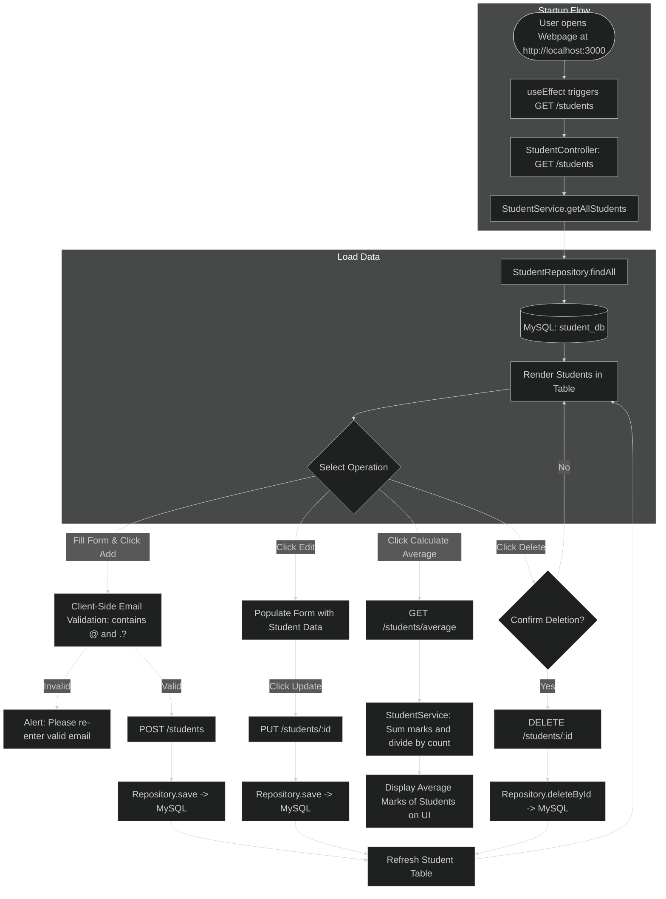
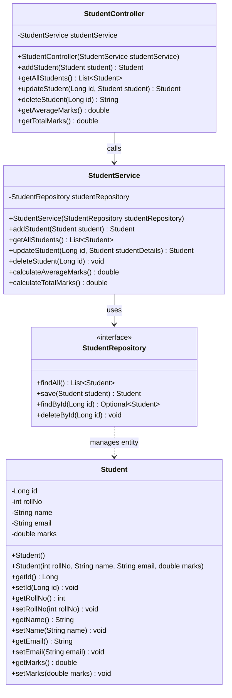

# Student Management System

A full-stack **Student Management System** built with **React**, **Java Spring Boot**, **Spring Data JPA**, and **MySQL**.

The application provides a responsive web interface for managing student records, performing client-side validation, executing full CRUD operations, and computing real-time academic analytics.

---

## Index / Table of Contents

| Sr. No. | Section |
| :---: | :--- |
| **1** | [Title, Description & Objectives](#1-title-description--objectives) |
| **2** | [Tools & Technologies](#2-tools--technologies) |
| **3** | [System Design – Flowchart & Class Diagram](#3-system-design--flowchart--class-diagram) |
| **4** | [Features, Frontend & Database Design](#4-features-frontend--database-design) |
| **5** | [Backend Design & Workflow](#5-backend-design--workflow) |
| **6** | [Sample Code Snippets](#6-sample-code-snippets) |
| **7** | [Application Preview & API Verification](#7-application-preview--api-verification) |
| **8** | [Conclusion & Future Scope](#8-conclusion--future-scope) |
| **9** | [How to Run the Project](#9-how-to-run-the-project) |

---

## 1. Title, Description & Objectives

### Project Title
**Student Management System**

### Description
The Student Management System is an end-to-end full-stack web application designed for streamlined academic record management. The platform allows administrators and instructors to register, view, update, and remove student profiles (`rollNo`, `name`, `email`, `marks`), validate form data in real time, and compute aggregate metrics such as class averages.

The system is built upon a standard 4-tier layered architecture:
$$\text{Client (React)} \longleftrightarrow \text{Controller (REST API)} \longleftrightarrow \text{Service (Business Logic)} \longleftrightarrow \text{Repository (Data Access)} \longleftrightarrow \text{Database (MySQL)}$$

### Objectives
1. **Object-Oriented Domain Modeling**: Model structured student entities with proper encapsulation, accessors, and constructors.
2. **Interactive Client Interface**: Provide a clean, accessible UI using semantic HTML5, CSS3 card layouts, client-side email format validation, and React hooks (`useState`, `useEffect`).
3. **Layered RESTful Backend**: Structure server-side logic into decoupled layers (`entity`, `repository`, `service`, `controller`) for maintainability and scalability.
4. **Relational Database Persistence**: Implement automated ORM schema generation and CRUD transactions via Spring Data JPA and Hibernate connected to MySQL.

---

## 2. Tools & Technologies

| Category | Technology / Tool | Version / Details | Purpose |
| :--- | :--- | :--- | :--- |
| **Frontend UI** | React.js | 18.x | Component-driven UI, state management via `useState`, and API lifecycle hooks via `useEffect` |
| **Validation** | JavaScript | ES6+ | Real-time input handling and email syntax validation |
| **Styling** | Modern CSS | CSS3 | Responsive cards, accessible forms, data tables, and interactive states |
| **Backend Language** | Java | JDK 17 / 21 | Core programming language for business logic and enterprise services |
| **Backend Framework** | Spring Boot | 3.2.x | RESTful API controllers, embedded Tomcat server, and dependency injection |
| **Persistence / ORM** | Spring Data JPA / Hibernate | JPA 3.x | ORM mapping, automated table updates (`ddl-auto=update`), and repository abstractions |
| **Database** | MySQL | MySQL 8.0+ | Relational persistence for student records (`student_db`) |
| **Build Tool** | Apache Maven | 3.x | Project lifecycle and backend dependency management |
| **Development IDE** | VS Code / IntelliJ / Eclipse | Standard | Application development and REST API testing |

---

## 3. System Design – Flowchart & Class Diagram

### 3.1 Flowchart



---

### 3.2 Class Diagram



---

## 4. Features, Frontend & Database Design

### 4.1 Key Features
- **Student Registration (Create)**: Capture roll number, student name, email, and academic marks.
- **Client-Side Validation**: Validate email format (`@` and `.`) before sending network requests.
- **Student Directory (Read)**: Tabular layout dynamically displaying all active student records.
- **Record Modification (Update)**: In-place form population for immediate updates without reloading.
- **Record Removal (Delete)**: Confirmation prompt to ensure safe record deletion.
- **Academic Analytics**: Server-side business calculation to compute average student marks (`calculateAverageMarks()`).

### 4.2 Frontend Design (React + CSS)
The user interface is contained inside [`frontend/src/App.js`](frontend/src/App.js) and styled via [`frontend/src/App.css`](frontend/src/App.css):
- **Form Card**: Clean inputs for student attributes with contextual Add/Update actions.
- **Table Card**: Styled table displaying `ID`, `Roll No`, `Name`, `Email`, `Marks`, and `Actions`.
- **Summary Box**: Dedicated calculation trigger and result badge presenting the computed average marks.

### 4.3 Database Design (MySQL)

#### Database: `student_db`
#### Table: `student` (Auto-generated by Hibernate from `@Entity Student`)

| Column Name | SQL Type | Constraints | Description |
| :--- | :--- | :--- | :--- |
| `id` | `BIGINT` | `PRIMARY KEY, AUTO_INCREMENT` | Unique identifier |
| `roll_no` | `INT` | `NOT NULL` | Student academic roll number |
| `name` | `VARCHAR(255)` | `NOT NULL` | Full student name |
| `email` | `VARCHAR(255)` | `NOT NULL` | Validated contact email |
| `marks` | `DOUBLE` | `NOT NULL` | Numerical score used for class metrics |

---

## 5. Backend Design & Workflow

The backend architecture follows a clean 4-tier structure:

1. **`Student.java` (Entity Layer)**:
   Annotated with `@Entity`, `@Id`, and `@GeneratedValue(strategy = GenerationType.IDENTITY)`. Represents the database model.
2. **`StudentRepository.java` (Data Access Layer)**:
   Interface extending `JpaRepository<Student, Long>`, providing built-in methods (`save`, `findAll`, `findById`, `deleteById`).
3. **`StudentService.java` (Business Logic Layer)**:
   Annotated with `@Service`. Handles transactional operations and computations such as calculating class averages.
4. **`StudentController.java` (Controller / API Layer)**:
   Annotated with `@RestController`, `@RequestMapping("/students")`, and `@CrossOrigin(origins = "*")`. Exposes RESTful endpoints.
5. **`application.properties` (Configuration)**:
   Configures the datasource connection (`spring.datasource.url`), JPA parameters (`ddl-auto=update`), and server port.

### REST API Endpoints

| HTTP Method | Route | Description | Request Body | Response Format |
| :--- | :--- | :--- | :--- | :--- |
| **GET** | `/students` | Retrieve all student records | None | `JSON Array of Students` |
| **POST** | `/students` | Register a new student | `Student JSON` | `Created Student JSON` |
| **PUT** | `/students/{id}` | Update existing student record | `Student JSON` | `Updated Student JSON` |
| **DELETE** | `/students/{id}` | Delete student by ID | None | `String ("Student deleted successfully")` |
| **GET** | `/students/average` | Calculate average marks | None | `double (e.g. 90.25)` |
| **GET** | `/students/total` | Calculate sum of marks | None | `double (e.g. 180.5)` |

---

## 6. Sample Code Snippets

### 6.1 Entity Layer (`Student.java`)
```java
package com.example.student.entity;

import jakarta.persistence.Entity;
import jakarta.persistence.GeneratedValue;
import jakarta.persistence.GenerationType;
import jakarta.persistence.Id;

@Entity
public class Student {

    @Id
    @GeneratedValue(strategy = GenerationType.IDENTITY)
    private Long id;

    private int rollNo;
    private String name;
    private String email;
    private double marks;

    public Student() {}

    public Student(int rollNo, String name, String email, double marks) {
        this.rollNo = rollNo;
        this.name = name;
        this.email = email;
        this.marks = marks;
    }

    public Long getId() { return id; }
    public void setId(Long id) { this.id = id; }
    public int getRollNo() { return rollNo; }
    public void setRollNo(int rollNo) { this.rollNo = rollNo; }
    public String getName() { return name; }
    public void setName(String name) { this.name = name; }
    public String getEmail() { return email; }
    public void setEmail(String email) { this.email = email; }
    public double getMarks() { return marks; }
    public void setMarks(double marks) { this.marks = marks; }
}
```

### 6.2 Service Layer (`StudentService.java`)
```java
package com.example.student.service;

import com.example.student.entity.Student;
import com.example.student.repository.StudentRepository;
import org.springframework.stereotype.Service;
import java.util.List;

@Service
public class StudentService {

    private final StudentRepository studentRepository;

    public StudentService(StudentRepository studentRepository) {
        this.studentRepository = studentRepository;
    }

    public Student addStudent(Student student) {
        return studentRepository.save(student);
    }

    public List<Student> getAllStudents() {
        return studentRepository.findAll();
    }

    public double calculateAverageMarks() {
        List<Student> students = studentRepository.findAll();
        if (students.isEmpty()) {
            return 0.0;
        }
        double total = 0;
        for (Student student : students) {
            total = total + student.getMarks();
        }
        double avg = total / students.size();
        return Math.round(avg * 100.0) / 100.0;
    }
}
```

### 6.3 React Component Logic (`App.js`)
```javascript
// Email validation logic
const validateEmail = (emailInput) => {
  if (emailInput.indexOf('@') === -1 || emailInput.indexOf('.') === -1) {
    alert("Invalid Email! Email must contain '@' and '.' characters. Please re-enter.");
    return false;
  }
  return true;
};

// Form state hooks
const [rollNo, setRollNo] = useState('');
const [name, setName] = useState('');
const [email, setEmail] = useState('');
const [marks, setMarks] = useState('');
const [averageMarks, setAverageMarks] = useState(null);
```

---

## 7. Application Preview & API Verification

### 1. Web Application User Interface
```
+-----------------------------------------------------------------------------------------+
|                                Student Management System                                |
+-----------------------------------------------------------------------------------------+
|  Add New Student                                                                        |
|  Roll Number:                          [ 101                      ]                     |
|  Student Name:                         [ Rahul Sharma             ]                     |
|  Email Address:                        [ rahul@gmail.com          ]                     |
|  Marks:                                [ 88.5                     ]                     |
|  [ Add Student ]                                                                        |
+-----------------------------------------------------------------------------------------+
|  Student Records                                                                        |
|  +----+---------+------------------+-------------------+-------+---------------------+  |
|  | ID | Roll No | Name             | Email             | Marks | Actions             |  |
|  +----+---------+------------------+-------------------+-------+---------------------+  |
|  | 1  | 101     | Rahul Sharma     | rahul@gmail.com   | 88.5  | [ Edit ] [ Delete ] |  |
|  | 2  | 102     | Sneha Patil      | sneha@gmail.com   | 92.0  | [ Edit ] [ Delete ] |  |
|  +----+---------+------------------+-------------------+-------+---------------------+  |
|                                                                                         |
|  [ Calculate Average Marks ]                                                            |
|  Average Marks of Students: 90.25                                                       |
+-----------------------------------------------------------------------------------------+
```

### 2. Client-Side Validation Alert
When entering an email lacking `@` or `.` (e.g. `rahulgmailcom`):
```
+-----------------------------------------------------------------------+
|  Alert: Invalid Email! Email must contain '@' and '.' characters.     |
|         Please re-enter.                                              |
+-----------------------------------------------------------------------+
```

### 3. REST API Verification
- `POST http://localhost:8080/students` $\longrightarrow$ `200 OK` (Record inserted into MySQL)
- `GET http://localhost:8080/students/average` $\longrightarrow$ `90.25` (Computed average of all students' marks)

---

## 8. Conclusion & Future Scope

### Architecture Summary
The **Student Management System** demonstrates solid full-stack engineering fundamentals:
- **Object-Oriented Design**: Clean entity structure, encapsulation, and type safety.
- **Responsive Frontend**: Event-driven architecture with form validation and state synchronization in React.
- **Enterprise Spring Architecture**: Multi-tier architecture (`Controller` $\to$ `Service` $\to$ `Repository` $\to$ `MySQL`) with automated schema management and transaction boundaries.

### Future Scope
1. **Search & Filter Operations**: Add client-side filtering by roll number or student name.
2. **Grade Calculation**: Extend the service layer to assign letter grades (A, B, C) based on marks.
3. **Pagination Support**: Support paginated queries for managing large batches of students.
4. **Export Options**: Export the student roster into downloadable CSV or PDF reports.

---

## 9. How to Run the Project

### Prerequisites
Make sure the following tools are installed:
- **Java JDK (17 or 21)**: Check using `java -version`
- **Apache Maven**: Check using `mvn -v`
- **Node.js & npm**: Check using `node -v` and `npm -v`
- **MySQL Server**: Ensure MySQL service is running

---

### Step 1: Set up MySQL Database
1. Open the terminal or Command Prompt and log in to MySQL:
   ```bash
   mysql -u root -p
   ```

2. Create the project database:
   ```sql
   CREATE DATABASE IF NOT EXISTS student_db;
   SHOW DATABASES;
   EXIT;
   ```
   *(Note: Hibernate automatically creates and updates the `student` table with all columns when Spring Boot starts up).*

3. *(Optional)* Verify database credentials inside [`backend/src/main/resources/application.properties`](backend/src/main/resources/application.properties):
   ```properties
   spring.datasource.url=jdbc:mysql://localhost:3306/student_db?createDatabaseIfNotExist=true&useSSL=false&allowPublicKeyRetrieval=true
   spring.datasource.username=root
   spring.datasource.password=root
   ```
   *(Update username and password if your local MySQL uses different credentials).*

---

### Step 2: Run the Spring Boot Backend
1. Open a terminal and navigate to the `backend` directory:
   ```bash
   cd backend
   ```

2. Start the application using Maven:
   ```bash
   mvn spring-boot:run
   ```

3. Look for the startup message in the terminal:
   ```text
   Started StudentAppApplication on port 8080
   ```
   Backend APIs are now live and accessible at: **`http://localhost:8080`**

---

### Step 3: Run the React Frontend
1. Open a second terminal and navigate to the `frontend` directory:
   ```bash
   cd frontend
   ```

2. Install dependencies (only required the first time):
   ```bash
   npm install
   ```

3. Start the React development server:
   ```bash
   npm start
   ```

4. Open in your browser:
   **`http://localhost:3000`**

---

### Step 4: Test the Application
1. **Add Student**: Enter Roll No, Name, Email, and Marks, then click **Add Student**.
2. **View Students**: The new student appears immediately in the table below.
3. **Edit Student**: Click **Edit** next to any record, modify the values in the form, and click **Update Student**.
4. **Delete Student**: Click **Delete** next to any student and confirm the alert popup.
5. **Calculate Average Marks**: Click **Calculate Average Marks** to invoke the backend business logic and view the average marks of all students.
